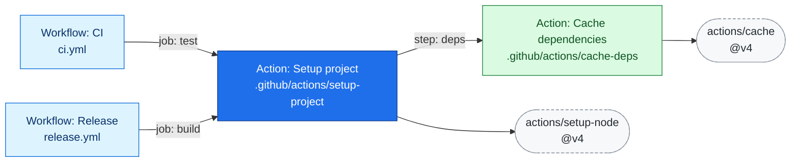
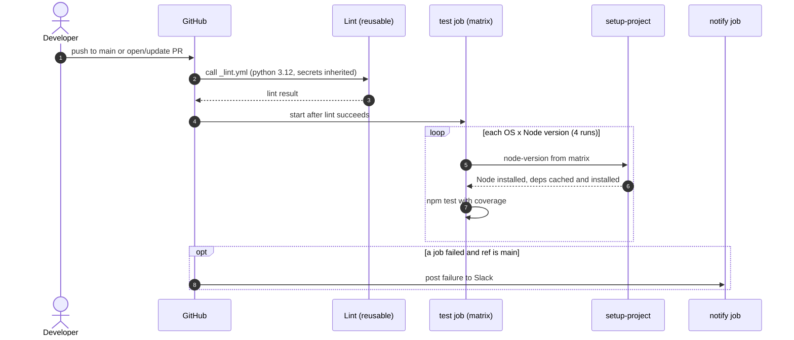

# github-actions-docs

A [Claude Code](https://claude.com/product/claude-code) skill that reads the `.github` folder of a repository and generates
Markdown documentation for every GitHub Actions **workflow** and **local action**, complete with Mermaid dependency
graphs and sequence diagrams.

Point it at a repository and ask *"document our GitHub Actions"*. You get one document per workflow or action, plus an
index that shows how everything fits together.

## What you get

```
docs/github-automation/
├── README.md                  index, repo-wide dependency map, cross-cutting notes
├── workflows/
│   ├── ci.md                  one document per workflow file
│   └── release.md
└── actions/
    └── setup-project.md       one document per local action
```

Every document covers:

| Section | Content |
|---------|---------|
| **Overview** | What it does and why it exists, in plain language rather than a restatement of the YAML |
| **Triggers** / **Usage** | Events with their filters, cron schedules in words, concurrency; for actions, who calls them and how |
| **Dependencies** | Local workflows and actions (linked to their own docs) and external actions with version and pinning (SHA, tag, floating major tag or branch) |
| **Dependency graph** | Mermaid flowchart showing what it calls and what calls it |
| **Configuration** | Inputs, outputs, secrets, variables, environment, permissions, runners, matrix |
| **Jobs** | Table of jobs with `needs`, conditions and purpose, plus a Mermaid job graph |
| **Sequence diagram** | Mermaid sequence diagram of a run from trigger to completion (or an explicit `Not applicable: <reason>`) |
| **Examples** | Real call sites from your repository first, then illustrative snippets, such as `gh workflow run` and `gh secret set` |
| **Notes and caveats** | Broken references, unpinned actions, secrets used but not declared, and other findings |

### Example output

Dependency graph generated for a composite action (arrows point from caller to dependency):



Sequence diagram for a pull-request CI workflow:



## Requirements

For normal skill use:

- [Claude Code](https://claude.com/product/claude-code)
- Python 3 and [PyYAML](https://pypi.org/project/pyyaml/) (`pip install pyyaml`)
- *Optional:* Node.js and npm, used by the validator to check diagrams with the real Mermaid parser. It installs `mermaid` and `jsdom` once into `~/.cache/github-actions-docs-mermaid`.

For the **Promptfoo evaluation suite**, also install Node.js 20+ and npm, plus an authenticated Claude Code CLI. See [Evaluating the skill with Promptfoo](#evaluating-the-skill-with-promptfoo).

## Installation

Clone this repository into your Claude Code skills folder.

**Personal skill, available in every project:**

```bash
git clone https://github.com/tcorral/github-actions-docs ~/.claude/skills/github-actions-docs
```

**Project skill, shared with your team through the repository you want to document:**

```bash
git clone https://github.com/tcorral/github-actions-docs .claude/skills/github-actions-docs
```

If you received a `github-actions-docs.skill` package instead, unzip it into one of the same locations.

## Usage

Open Claude Code **inside the repository that contains the `.github` folder** and ask in your own words:

> Document our GitHub Actions workflows and actions.

> Generate docs for `.github` with dependency graphs and sequence diagrams.

> Explain what our CI pipelines do and how they depend on each other.

Output goes to `docs/github-automation/` unless you name another folder (*"…write the docs to `docs/ci/`"*).

The skill only **reads** `.github/`. It never modifies your workflows or actions.

### Regenerating

Run it again at any time. Documents are regenerated from the current source rather than appended to. Anything you
write between these markers is preserved verbatim:

```markdown
<!-- manual:start -->
Your own notes, runbooks, links…
<!-- manual:end -->
```

## How it works

The work is split between deterministic scripts and Claude:

1. **Scan** (`scripts/scan_github.py`): parses every workflow and local action, resolves local `uses:` references,
   detects `workflow_run` chaining and `gh workflow run` calls, and pre-computes Mermaid flowcharts. Output is a
   JSON inventory. The same input always gives the same structure.
2. **Understand and write** (Claude): reads the inventory *and* the source YAML, comments and scripts that steps call, then
   writes the prose, configuration examples and sequence diagrams using the templates in `references/`.
3. **Validate** (`scripts/validate_docs.py`): checks that every workflow and action has a document with the
   required sections, that links resolve, that the index links everything and that Mermaid blocks are well-formed.
   With `--mermaid` it also parses them with the real Mermaid parser.

### Using the scripts directly

```bash
# Overview of everything found, with warnings
python3 scripts/scan_github.py --list

# Full JSON inventory
python3 scripts/scan_github.py --out /tmp/gha-inventory.json

# One workflow or action as JSON
python3 scripts/scan_github.py --item .github/workflows/ci.yml

# Validate generated docs (add --mermaid for the real parser)
python3 scripts/validate_docs.py --inventory /tmp/gha-inventory.json --docs docs/github-automation --mermaid
```

Run these from inside the repository, or pass `--root /path/to/repo` to the scanner.

### What the scanner warns about

- Local `uses: ./…` references that do not resolve to a file
- `needs:` pointing at a job that does not exist
- `gh workflow run x.yml` where `x.yml` has no `workflow_dispatch` trigger
- `workflow_run` pointing at an unknown workflow
- YAML files that fail to parse (the document is still created and says so)
- External actions that are not pinned to a commit SHA (summarised in the index)

## Repository layout

```
github-actions-docs/
├── SKILL.md                   instructions Claude follows (entry point of the skill)
├── README.md                  this file
├── package.json               Promptfoo dependency and npm scripts
├── promptfooconfig.yaml       Promptfoo evaluation scenarios
├── evals/
│   ├── README.md               detailed evaluation instructions
│   ├── provider.cjs            runs the skill through Claude Code
│   ├── assertions.cjs          checks generated documentation
│   └── fixtures/example/       example repository (.github/ is hidden)
├── scripts/
│   ├── scan_github.py         inventory + dependency graphs
│   ├── validate_docs.py       completeness and diagram checks
│   └── check_mermaid.mjs      Mermaid parser used by --mermaid
└── references/
    ├── doc-templates.md       document structure and writing principles
    └── mermaid-guide.md       diagram conventions, safe syntax, sequence-diagram patterns
```

## Scope and limitations

- **Local analysis only.** External actions (`owner/repo@ref`) are listed with version and pinning status. They are not fetched or analysed.
- **`gh workflow run` detection is heuristic.** Such edges are drawn dotted, and the docs say "appears to dispatch".
- **Dynamic references** (`uses: ${{ … }}`), generated workflows and `repository_dispatch` chains cannot be resolved statically.
- **Things that live outside the repository**, such as environment protection rules, secret values and organisation-level policies, are not visible. The docs mark them as unknown instead of guessing.
- **Behaviour of repo scripts and JavaScript or Docker action sources** is only documented when the files are available to read.
- `.github` files other than workflows and actions (`CODEOWNERS`, `dependabot.yml`, issue templates…) are listed in the index but not documented.

## Troubleshooting

| Symptom | Fix |
|---------|-----|
| `PyYAML is required` | `pip install pyyaml` |
| `No .github folder found` | Run Claude Code from inside the repository, or use `--root` with the scripts |
| `--mermaid` is skipped | Install Node.js and npm, or ignore: the structural checks still run |
| A workflow's doc says it could not be parsed | Fix the YAML error shown in the scanner warning, then regenerate |
| Skill does not trigger | Check that `SKILL.md` is at `~/.claude/skills/github-actions-docs/SKILL.md` (or the project-level equivalent), then restart Claude Code |

## Evaluating the skill with Promptfoo

This repository includes an end-to-end evaluation suite using [Promptfoo](https://www.promptfoo.dev/). It runs the **actual Claude Code skill** against a small GitHub Actions fixture repository and checks the **Markdown files written to disk**, not just Claude's final chat response. It is intended to catch behavioral regressions when `SKILL.md`, templates, or supporting scripts change.

### Prerequisites and setup

Install **Node.js 20 or later**, npm, Python 3 with PyYAML, and the [Claude Code CLI](https://code.claude.com/docs/en/overview). Authenticate Claude Code with an account that has model access.

From the root of this repository:

```bash
python3 -m pip install pyyaml
claude --version
npm install
```

If Claude Code is not authenticated, run `claude` interactively and complete the sign-in flow before evaluating. The suite uses your Claude Code authentication; a separate Promptfoo API provider or `ANTHROPIC_API_KEY` is not required for this setup. Model calls may incur costs or consume plan usage.

### Run the evaluations

From the root of the **skill repository** (not the fixture):

```bash
npm run eval
```

This is equivalent to:

```bash
npx promptfoo eval -c promptfooconfig.yaml --no-cache
```

The `--no-cache` flag reruns Claude Code rather than reusing cached responses. After the evaluation, inspect the results in Promptfoo's viewer:

```bash
npm run eval:view
```

Or run `npx promptfoo view` directly. The results indicate which assertions passed or failed, along with diagnostic details. A passing run means the defined assertions passed; it is not a guarantee of all possible documentation correctness.

### Scenarios and expectations

The suite currently contains **three end-to-end scenarios**, defined in `promptfooconfig.yaml`:

| Scenario | Expected behavior |
|----------|-------------------|
| Full repository documentation | Generate an index and documentation for all five workflows and four local actions, with source-faithful triggers, dependencies, configuration, links and diagrams. |
| Custom output directory | Generate documentation under `docs/ci-reference/`, as requested, rather than the default directory. |
| Regeneration | Regenerate existing documentation while preserving the content inside `<!-- manual:start -->` and `<!-- manual:end -->`. |

The fixture at `evals/fixtures/example/` exercises reusable workflows, nested composite actions, `workflow_run` chaining, matrix jobs, scheduled runs, secrets and variables, permissions, external action pinning, a broken local action reference, and an unused local action. **Its `.github/` directory is hidden by default** in some file explorers. Verify its contents with:

```bash
find evals/fixtures/example -type f
```

### How the suite works

1. `evals/provider.cjs` copies the fixture to a temporary directory for each test case.
2. It links the current checkout of this skill into the fixture's `.claude/skills/github-actions-docs/` directory.
3. It invokes the authenticated `claude` CLI with the request from `promptfooconfig.yaml`.
4. It collects the generated Markdown under the scenario's selected output directory.
5. `evals/assertions.cjs` checks the collected files against coverage, structure, and source-specific expectations.
6. Promptfoo reports the assertion results.

The tests are **behavioral**, not exact prose snapshots. Legitimate wording differences are acceptable when the asserted facts and documentation structure are present. The assertions cannot establish complete semantic correctness or verify that the workflows themselves execute successfully.

### Debugging evaluation failures

Keep the temporary fixture copies for inspection:

```bash
SKILL_EVAL_KEEP_WORKDIR=1 npm run eval
```

The provider prints the retained temporary working directories to standard error. Inspect the generated Markdown there to diagnose missing pages or incorrect assertions.

If Claude Code needs more time, increase the per-scenario timeout (milliseconds; the default is `600000`, or 10 minutes):

```bash
SKILL_EVAL_TIMEOUT_MS=900000 npm run eval
```

If a case fails before generating documentation, verify `claude --version`, authentication, Python/PyYAML availability, and the error output shown by Promptfoo. See [`evals/README.md`](evals/README.md) for additional details.

### Validation beyond Promptfoo

Promptfoo checks selected end-to-end expectations. The deterministic validator independently checks required sections, links, document coverage, and Mermaid structure. When validating a generated repository, run the scanner **in that target repository**, then point the validator at the resulting inventory and docs:

```bash
python3 /path/to/github-actions-docs/scripts/scan_github.py \
  --out /tmp/gha-inventory.json
python3 /path/to/github-actions-docs/scripts/validate_docs.py \
  --inventory /tmp/gha-inventory.json \
  --docs docs/github-automation \
  --mermaid
```

The `--mermaid` option checks diagrams with the actual Mermaid parser if the required Node/npm tooling is available. This validator is a complementary check, not a replacement for evaluating Claude's behavior.

### Security

The evaluation provider invokes Claude Code with **`--dangerously-skip-permissions`** to avoid interactive approvals. Run the suite only with **trusted fixtures in an isolated development environment**, without unnecessary credentials. Do not run it automatically against untrusted pull-request content. The fixture does not need real deployment tokens or webhook secrets.

### Extending the suite

When introducing a feature or fixing a regression, add representative workflows/actions under `evals/fixtures/example/`, a case in `promptfooconfig.yaml` if needed, and source-grounded expectations in `evals/assertions.cjs`. Update `evals/provider.cjs` only for scenarios that require different setup or output collection. Prefer checking observable facts and behavior instead of exact prose, then run `npm run eval` again.

## Contributing

When changing `SKILL.md`, the documentation templates or supporting scripts, run `npm run eval` to check for behavioral regressions. When changing the scanner, also test it on a repository that exercises reusable workflows, nested composite actions, `workflow_run` chains and at least one broken reference, then confirm that `validate_docs.py --mermaid` passes on the generated docs. Both checks are complementary and should pass before submitting a pull request.

## License

See [LICENSE](LICENSE).
