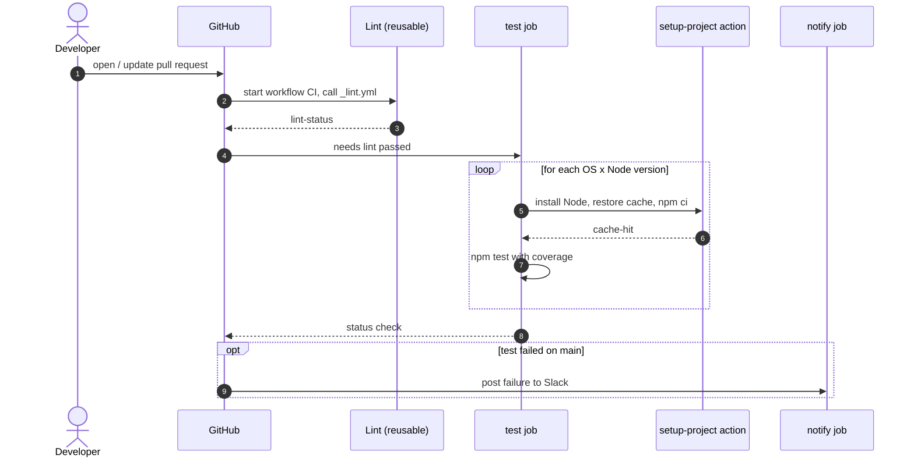
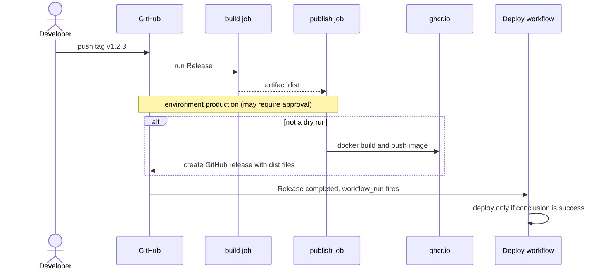
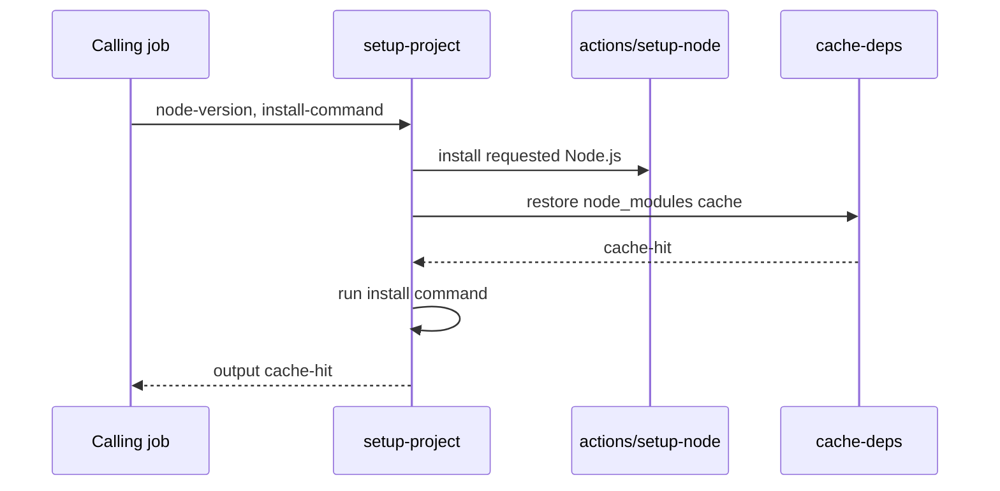

# Mermaid guide for GitHub Actions docs

GitHub renders Mermaid natively in Markdown, so diagrams must be plain ```` ```mermaid ```` fences. Two diagram
types are used: **flowcharts** (dependency graph, job graph – pre-generated by the scanner) and **sequence
diagrams** (written by you).

Contents: [Safe-syntax rules](#safe-syntax-rules) · [Dependency graph](#dependency-graph) ·
[Sequence diagrams](#sequence-diagrams) · [Patterns](#patterns) · [When to skip a sequence diagram](#when-to-skip-a-sequence-diagram)

## Safe-syntax rules

Most broken diagrams come from a handful of causes. Following these keeps GitHub's renderer happy:

- Quote every label that contains anything but letters and spaces: `A["CI (push)"]`, `-->|"job: test"|`.
- Never use a bare `end` as a node id or label (it closes blocks). Use `finish` or quote it.
- Declare sequence participants explicitly with short aliases: `participant R as Runner`. Aliases are `[A-Za-z0-9_]`
  only; put anything fancier in the display name.
- Escape or avoid `;`, `#`, `%%` and unbalanced quotes inside message text. Use `#59;` for a literal semicolon.
  Don't put `${{ }}` expressions in diagrams – paraphrase them ("if on main", "for each matrix entry").
- Line breaks: `<br/>` in flowchart labels and sequence messages; never a raw newline inside a label.
- Keep message text short (≈ 60 chars). Detail belongs in the surrounding prose.
- Balance every `alt`/`opt`/`loop`/`par`/`critical`/`rect` with `end`; `else` / `and` stay inside their block.

## Dependency graph

Start from `dependency_graph.mermaid` in the inventory – it is already syntax-checked. You may adjust labels or
drop noise, but keep the conventions so graphs look the same across the repo:

- Arrows point **from the caller to what it depends on**.
- Thick `==>` reusable-workflow call · thin `-->` action use · dotted `-.->` event chaining
  (`workflow_run`, `gh workflow run`) · dashed box = external action.
- Blue = the item being documented, light blue = workflow, green = local action.

Always include the `legend` text under the diagram. The inventory omits `dependency_graph` when an item has no
dependencies and no callers; then write `Not applicable: <reason>` (e.g. "uses no other actions and is not
referenced by any workflow").

For the index README use `repo_graph` from the inventory (all items, no externals, same styling).

## Sequence diagrams

A sequence diagram answers: *"when this runs, who talks to whom, in what order, and what can vary?"* Choose
participants that a reader would recognise as actors, not one per YAML key.

**Participants (pick what applies):**

| Participant | Alias | When |
|-------------|-------|------|
| The event source (`Developer`, `Scheduler`, `Upstream workflow`) | `Dev`, `Cron`, `Up` | always – the trigger |
| `GitHub` (events, checks, environments approvals, releases) | `GH` | when GitHub itself acts (status checks, approvals, releases) |
| The workflow / each job | `WF`, `Build`, `Test` | one participant per job, for multi-job workflows |
| Local actions / reusable workflows | `Setup`, `Lint` | when called |
| External systems (registry, cloud, Slack, Codecov) | `Reg`, `Cloud`, `Slack` | only when a step really talks to them – confirm from `run:` scripts or the action's purpose |

**Conventions:**

- `->>` request/call, `-->>` response/return or artifact hand-off, `-x` failure path where it matters.
- Model `needs:` ordering by the order of messages; model parallel jobs with `par … and … end`.
- `strategy.matrix` → `loop for each matrix entry` or a `Note over` stating the dimensions.
- `if:` conditions → `alt`/`opt` blocks with a paraphrased condition.
- `environment:` with required reviewers → a message to `GH` and `Note over GH: waits for approval` (only say
  "approval" if the environment is declared; you cannot see its protection rules from the repo, so phrase it as
  "environment `production` (may require approval)").
- Use `autonumber` for long flows. Add `Note over` sparingly for concurrency, permissions or cancellation.
- Show outputs/artifacts being handed between jobs (`Build-->>Publish: artifact dist`).

## Patterns

### 1. Pull-request CI with reusable workflow, local action and matrix



### 2. Tag release with manual approval gate and downstream workflow_run



### 3. Composite action



### 4. Scheduled / dispatch-only workflow

Keep it small: `Cron->>WF: nightly at 02:00 UTC`, then the one or two things it does, including any
`gh workflow run` that starts another workflow (a dotted dependency worth showing).

## When to skip a sequence diagram

Write `Not applicable: <reason>` rather than a padded diagram when:

- there is a single job with ≤ 2 trivial steps and no other actor (e.g. "single `echo` step"),
- a JavaScript/Docker action whose source is not in the repo, so its behaviour can't be known,
- the only content would be "Trigger → job → done".

When in doubt for a multi-job workflow, a composite action with ≥ 3 steps, or anything calling other workflows or
actions: include the diagram. Readers use it to understand ordering, which prose conveys poorly.

## Checking your diagrams

`python scripts/validate_docs.py --inventory <inv.json> --docs <doc-dir> --mermaid` runs structural checks plus
the real Mermaid parser (needs node + npm; installs once into `~/.cache/github-actions-docs-mermaid`). Fix every
reported block before finishing; the parser's message names the failing diagram and usually the offending line.
